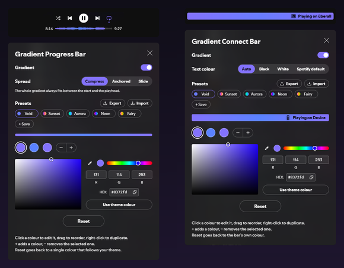

# Gradient Bars

My [Spicetify](https://spicetify.app) extensions that recolour Spotify's bars with one colour, or several blended into a gradient.

| Extension | What it recolours |
|---|---|
| **Gradient Progress Bar** | The song progress bar. |
| **Gradient Connect Bar** | The Connect bar, the "Playing on …" strip below the player while music plays on another device. |
| **Gradient Bars** | Both. It's the two above in one file. |

Install **either Gradient Bars or the ones you want separately, not both**. Gradient Bars uses the same settings, so you can switch without losing anything. If you do end up with both, the second copy steps aside and leaves a warning in the console.

<p align="center"></p>

## Features

- **Solid colour or gradient**: up to 8 colours in a built-in colour picker with R/G/B and hex input, reordered by dragging.
- **Theme colour**: a colour that follows your theme's accent, also when the theme changes it per song (like Hazy's album-art mode).
- **Presets**: five built-in gradients and up to 12 of your own, with a preview and Undo.
- **Share codes**: copy your settings as a short code and paste someone else's. Codes work across both bars.
- **Progress bar only:** three ways to spread the gradient (*Compress*, *Anchored*, *Slide*).
- **Connect bar only:** the text colour (*Auto* picks black or white, whichever stays readable over the whole gradient).
- **Leaves everything else alone**: no `!important`, no layout changes, nothing outside the bars. With default settings nothing changes at all.

## Installation

**Spicetify Marketplace:** search for **Gradient Bars**, **Gradient Progress Bar** or **Gradient Connect Bar** and click *Install*.

**Manual:** download the file from [`dist/`](dist) (`gradientBars.js`, `gradientProgressBar.js` or `gradientConnectBar.js`), copy it into the `Extensions` folder inside your Spicetify config folder (`spicetify config-dir` shows where), then:

```sh
spicetify config extensions gradientBars.js
spicetify apply
```

To uninstall: `spicetify config extensions gradientBars.js-` and `spicetify apply` (same with the other file names).

## Usage

Open the settings with the **brush button** in the top bar (one button; with both bars it opens a small menu), from the **profile menu**, or by **right-clicking a bar**. The Connect bar is only there while music plays on another device.

In the settings: click a colour dot to edit it, right-click it to duplicate or remove it, drag it to reorder. **− | +** removes the selected colour or adds one. Click a preset once to preview it in the strip and again to apply it. **Export** copies a share code, **Import** takes one. **Reset** asks for a second click.

## Compatibility

Tested with [Hazy](https://github.com/Astromations/Hazy) (the theme colour follows its accent) and [playback-bar-waveform](https://github.com/Konsl/spicetify-extensions) (the gradient is drawn inside the waveform), on Spotify 1.3.6 with Spicetify 2.46.

## Troubleshooting

- **After a Spotify update the bars are back to normal:** updates remove Spicetify's patch. Run `spicetify apply`.
- **A setting I changed just before `spicetify apply` is gone:** on Windows, `spicetify apply` force-closes Spotify (`taskkill /F`), which loses settings changed shortly before. Close Spotify normally first (*⋯* → *File* → *Exit*).
- **Something looks wrong:** [open an issue](https://github.com/VoidCrowned/spicetify-gradient-bars/issues/new/choose). The form says which self-test to paste ([how to open the devtools console](TESTING.md#opening-the-devtools-console)).

More: [ROADMAP.md](ROADMAP.md), [CHANGELOG.md](CHANGELOG.md), [CONTRIBUTING.md](CONTRIBUTING.md).

## Licence

Copyright © 2026 VoidCrowned. This program is free software. It comes without any warranty, to the extent permitted by applicable law. You can redistribute it and/or modify it under the terms of the Do What The Fuck You Want To Public License, Version 2, as published by Sam Hocevar. See [LICENSE](LICENSE) or http://www.wtfpl.net/ for more details.
